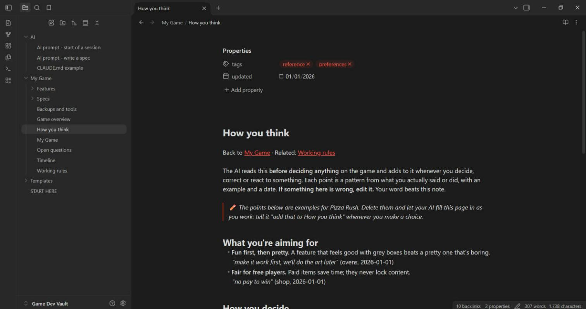

# Game Dev Vault

**A free Obsidian template that gives your AI a memory while you build a game.**

AI assistants forget everything between chats. This vault fixes that: your decisions, plans, rules and progress live in plain notes that the AI reads before it works and updates after. It stops asking the same questions, stops undoing your choices, and builds things *your* way.

Made for Roblox games, works for any game or project. By **Doom Studio**.

## Download

Get **`Game-Dev-Vault-vX.Y.zip`** from the [Releases](../../releases) page, unzip it, then in [Obsidian](https://obsidian.md) (free) choose **Open folder as vault** and pick the `Game Dev Vault` folder. Open **START HERE** first.

## What's inside

| Page | What it's for |
|---|---|
| **How you think** | Your taste and habits, with real quotes. The AI reads this first. |
| **Working rules** | Hard rules: backups, testing, what needs your OK. |
| **Game overview** | Every system in your game and where its scripts are. |
| **Timeline** | What was done, day by day. |
| **Open questions** | Decisions waiting for you. |
| **Backups and tools** | Every backup and helper tool, so nothing gets lost. |
| **Specs/** | One page per feature request, from a template. |
| **Features/** | One page per finished system: how it works, how to change it. |
| **AI/** | Copy-paste prompts and a ready `CLAUDE.md` for Claude Code. |
| **Templates/** | Spec, feature page, timeline entry, bug report. |

Everything is filled in for a made-up example game, **Pizza Rush**, so you can see what good notes look like.

## The loop

1. Write a **spec** (or let the AI interview you and write it).
2. The AI **reads the vault**, explains its plan in plain words, and waits for your OK.
3. It **builds and tests**, then reports *cause → fix → how it was tested*.
4. It **updates the vault**: timeline, feature page, open questions, and what it learned about how you think.

Every session makes the next one smarter.

## Works with

- **Claude Code** (best: reads and writes the vault itself)
- Claude, ChatGPT or any chat AI (paste the key pages in)
- Cursor / VS Code with AI

## Licence

MIT: free to use, change and share. A credit to Doom Studio is appreciated, not required.
